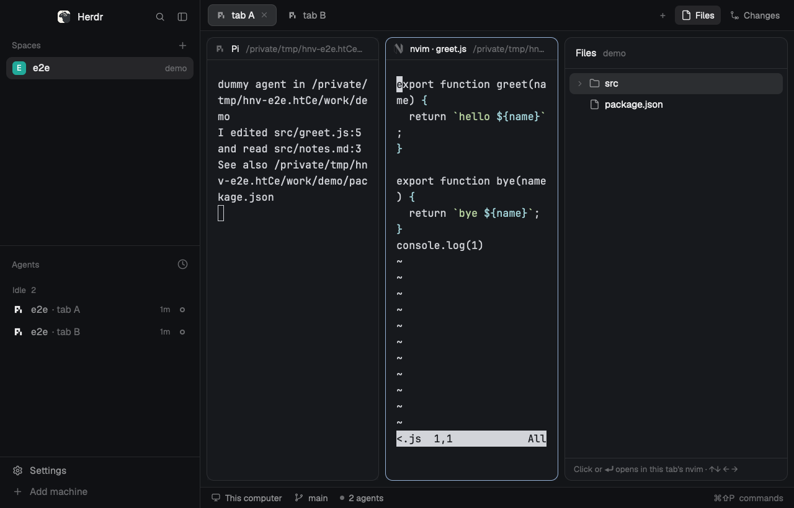

# herdr-nvim

Neovim in every tab, with a native file tree beside it, opened and closed as
one. The tab bar's **Files** button (or `cmd-e`) shows a narrow native tree of
the tab's folder on the right and, directly left of it, the tab's own nvim: a
real nvim terminal in a full-height pane, backed by a persistent per-tab nvim
(buffers, LSPs and pending comments survive closing it). Picking a file in the
tree opens it in that nvim. `cmd-o` lists the files the tab's agent read and
edited, newest first. Code comments written in nvim go to the tab's agent with
file:line context. It is a mod for the person's own window: the install puts
the tree into their layout's `files` slot (see Watch out for why it edits
their layout).

## What you see

- **Files panel** (right edge of the window, 300px by default): a 42px header
  with "Files" (semibold) and the folder name in `dim`, a ring spinner
  (`svg(...).spin(900)`, `muted`) while a file opens. Below, 28px rows:
  chevron, folder/file icon (the shipped `files` mod's SVGs, `muted`), name,
  and a git mark (`A` in `ansi2`, `D`/`U` in `ansi1`, `M` in `blocked`); the
  selected row on `selected`, hover on `hover`; background `background`, a
  1px `border` frame with 10px corners, `accent` while the tree has the
  keyboard. While the root is not the tab's folder, the header shows the way
  back as crumbs (`accent`, each a click). A footer hint in `dim`: "? keys".
- **nvim pane**, directly left of the panel: it splits the whole tab, so it is
  as tall as the tab, and the tab's other panes keep their arrangement on its
  left (the tab area is shared half and half; drag the divider). Its header
  reads `nvim · <file>`. nvim's own file explorer is not opened.
- **Preview** (`herdr-nvim-header`, the app's pane header plus one button):
  on the nvim pane's header, while nvim's file is markdown, an image or an
  SVG, a **Preview** button (11.5px, medium, a 1px `border` pill, `hover`
  on hover) at the right end, always shown. The preview pane takes nvim's
  place: markdown rendered (`TextView.markdown`, selectable, scrolling),
  an image or SVG fitted with 14px around it; its header reads
  `Preview · <file>` with a **Source** button (**nvim** for an image or an
  SVG). A file it can't show reads "Too big to preview (N MB)." or "The file
  is gone." in `dim`.
- **Picker** (`cmd-o`, the `herdr-nvim.pick` command): an 820×470 dialog titled "Open file from agent
  output" on a 38px `chrome` bar with the picker's keys as keycaps; under
  it herdr-nvim's terminal picker: the files the agent's session log shows it
  touched (newest first), then uncommitted git changes, with `+N -M` diff
  stats and ages; typing fuzzy-searches the whole repo.
- **Annotations** (inside nvim, default `<leader>a…` maps): `ac` comment the
  line or selection, `al` list, `as` paste all comments into the agent's
  input, `aS` send them (submitted), `ai` reference `path:line`.

### The tree's keys (LazyVim's Snacks explorer defaults)

The tree takes the keyboard from `pane.go` (the person's pane keys), from a
click, and from `cmd-shift-e`, which opens the pair if needed and selects the
file nvim shows. In nvim, LazyVim's `<leader>E`, `<leader>fe` and `<leader>fE`
do the same instead of opening nvim's own explorer.

**The tree key** (`[app] tree_key`, default `<leader>e`) toggles the tree
like LazyVim's explorer:

| Where | the tree key |
|---|---|
| nvim, tree hidden | shows the tree and puts the keyboard there, on nvim's file |
| nvim, tree showing | hides the tree; nvim stays open with the keyboard |
| the tree | hides the tree and gives nvim the keyboard (the same keys, with nvim's leader: `space` `e` in LazyVim) |

Which nvim gets it (with `tree = "native"`; read when nvim starts): a key
that opens a known explorer (Snacks, neo-tree, nvim-tree) is taken over; a
free key (plain nvim) is mapped; a key mapped to anything else, or one that
starts or ends a longer mapping, is left alone. `tree_key = ""` maps
nothing, and any lhs works (`"<C-n>"`, `"<leader>t"`). `cmd-e` and the Files
button still open and close both together.

The tree's keys are one table, `mods/herdr-nvim/tree-keys.js`: the tree runs
them, `?` lists them, and this table is that file's output
(`node mods/herdr-nvim/tree-keys.js`; the e2e checks they match):

| Key | Does |
|---|---|
| `j`/`k`, ↓/↑ | move |
| `g`/`G` | first / last row |
| `l`, ⏎, → | open the file in the tab's nvim (it takes the keyboard), or open/close the folder |
| `h`, ← | close the folder (the open one, else the row's) and stand on it |
| `/` | find: type to fuzzy-search every file under the root (fff); ⏎ opens, Esc returns |
| Backspace | root up a folder |
| `.` | the row's folder becomes the root |
| `~` | root: back to the tab's folder |
| `q`, Esc | back to the tab's nvim (Snacks closes its window; here the pair closes with cmd-e) |
| `a` | new file in the row's folder (a dialog); end with `/` for a folder; a new file opens in nvim |
| `r` | rename (a path in the root; nvim's buffers, unsaved edits and language servers follow) |
| Tab | select the row (●) for `m`, `c`, `d`, `y` |
| `m` | move the selected rows into the row's folder (confirm); with none selected, rename |
| `c` | copy the selected rows into the row's folder (confirm); with none, copy to a new name |
| `d` | delete (confirm); to the trash when the person's Snacks says so; their buffers close |
| `y` / `p` | yank the paths into nvim's register / paste those files into the row's folder |
| `o` | open with the system's app |
| `H` | show hidden files (starts as the person's Snacks explorer has it) |
| `I` | show git-ignored files (starts as the person's Snacks explorer has it) |
| `Z` | close every folder |
| `u` | list again |
| `?` | every key, in a list |
| the tree key (`space` `e`) | hide the tree, back to nvim (nvim stays) |

## How it behaves

- **`tree` setting** (herdr-nvim's config, `[app] tree`, read at each use;
  `install.sh --tree native|nvim` writes it): `native` (default) is what this
  recipe describes; `nvim` makes the Files button and `cmd-e` toggle only the
  tab's nvim pane, with nvim's own explorer opened inside it (the Files panel
  shows for a moment and is put away), and leaves `<leader>e` as it was.
- A bad `[app]` value (a `tree` other than `native`/`nvim`, a `tree_key`
  that isn't a string) warns and falls back to the default; it never resets
  the rest of the config (`[sidebar]`, `[picker]`, which the TUI plugin uses).
- **`tree_key` setting** (`[app] tree_key = "<leader>e"`, the default; any
  nvim lhs, or `""` for none): the key above. nvim reads it when it starts:
  after a change, close the pair and stop the tab's nvim
  (`bin/herdr-nvim daemons stop <space:tab>`), or open a new tab.
- **Files button = `cmd-e`**: in a tab without them, both open together (the
  panel, and the tab's nvim pane with the keyboard); pressing again closes
  both. Closing never stops the tab's nvim: reopening reattaches to the same
  process, same buffer and cursor. With nvim open and the tree hidden (by the
  tree key), they show the tree; pressed again, they close both.
- **Switching tabs or spaces**: the panel follows the tab you land on. A tab
  whose nvim pane is open shows the panel with it, unless the tree key hid
  the tree in that tab (it stays hidden until the panel is shown there again,
  or that nvim closes); a tab without one shows
  no panel. Looking at a tab never opens an nvim in it: nvim panes are per
  tab, the panel is per window. Switching the panel to Changes leaves the nvim
  pane open (Changes can open files in it); Files brings the tree back.
- **The pair stays a pair**: if the nvim pane opens some other way (the
  picker, `open`, another mod), the panel opens with it; if it goes (`:q`,
  closing the pane), the panel goes too.
- Click a file in the tree (or ↑↓ and ⏎ once the tree has the keyboard; ←/→
  fold and unfold): it opens in the tab's nvim pane, which takes the keyboard.
  Folders expand in place. The tree follows the focused tab's folder and
  refreshes when anything under it changes (a folder watch, no polling):
  only the open folders a change touches are listed again, and git marks
  follow at most every 2 s. `/` searches once typing pauses (120 ms), one
  search at a time, never above the tab's folder.
- **File operations** keep nvim in step: a rename or move renames the open
  buffer itself, so unsaved edits, the modified flag and undo stay (and a
  plain `:w` still works). Every path is checked as the file system resolves
  it: a symlink in the tab's folder pointing elsewhere is outside it.
- **Picker**: reads the focused tab's agent (the focused terminal if it is an
  agent, else the agent in the same tab, else the first agent of the space).
  Its session log comes first (pi: `~/.pi/agent/sessions/--<cwd>--/*.jsonl`;
  Claude Code: `~/.claude/projects/<cwd>/*.jsonl`; the newest log written
  since the agent's process started), then uncommitted git changes; without a
  log, the paths on the agent's screen. ⏎ opens the file in the tab's nvim
  (at the line the agent named, for a path taken from its screen) and focuses
  it; Esc closes the dialog. With nothing to list, an 8-second warning toast
  says why.
- Annotations go to the tab's agent: the only agent of the space, or the only
  one in this tab; otherwise nvim asks which. "Send" pastes and presses Enter
  once the person has stopped typing for ~3 s (`hc send`); "paste" leaves the
  text in the agent's input. A working agent gets a warning in nvim; blocked,
  done and idle agents are treated alike.
- Closing a tab stops that tab's nvim (and its LSP servers) within a second;
  closing a space stops all of its tabs'. Unsaved buffers are discarded. An
  nvim whose tab no longer exists is stopped when the watcher starts (the
  first nvim pane after a restart). An nvim that doesn't answer within 2 s
  (waiting at a prompt) is kept: what it holds is unknown. The layout
  document is read strictly: one space or tab it can't read makes the whole
  document unknown, and then nothing is stopped.
- **Stale nvims**: a tab's nvim outlives the pair closing, so after an
  install it still runs the herdr-nvim it started with. The install stops
  none; it reports how many are stale (`nvim: 1 of 2 running tab nvim(s) are
  stale …`), and `bin/herdr-nvim daemons` marks them `· stale`. Reopening a
  tab's pair restarts a stale clean nvim on the installed runtime; one with
  unsaved buffers or pending comments is kept, with a warning toast and a
  message in nvim saying to save and reopen.
- **Uninstall** takes out keys still bound to herdr-nvim and herdr-nvim's
  edits from every personal layout, and keeps every layout (none is deleted
  or switched; the copy it made stays the person's). It stops the app's
  nvims, except ones with unsaved work, which it lists and keeps (with their
  runtime) unless `--force`.
- Cmd+click on a path in a terminal is Herdr's: it opens the system default
  app, not nvim (no link handlers yet, herdrdev/herdr-app#228). Use the tree
  or the picker; `bin/herdr-nvim open-link <path>` opens a path in the
  focused tab's nvim, taking the line from the agent's own `path:line`
  mention when the path came without one (for a system opener).
- Other mods open files in a tab's nvim with
  `<appHome>/mods/herdr-nvim/bin/herdr-nvim open --tab <tab id> <file>[:line[:col]]`
  (relative paths resolve against the tab's folder; prints
  `{"terminal": "tN"}`; the panel opens with it). It needs no herdr-nvim mod
  copy on screen.

- **Preview / Source** swap in place: the pane header's button (and an
  image or SVG opened any way: Enter in the tree, `cmd-o`, `herdr-nvim open`
  from gitview or a link, which nvim can't show) asks herdr-nvim's controller for the swap
  (`herdr-nvim.swap:<tab>:<file>`; no file: Source). For Preview the
  controller splits the old pane across the split that made nvim's slot
  (`app-config`'s `across`: down for a side nvim), so both nest in the
  slot, and closes the old pane once the new preview is in the tab: the
  preview has the old pane's exact size. One that doesn't come in 5 s
  closes nothing and says so. Source is `toggle --state open`: herdr-nvim
  puts nvim in the preview's place the same way (after restarting a stale
  clean nvim, as Files does). nvim keeps running meanwhile (its daemon),
  with its buffers, cursor, undo and unsaved edits. Until
  the swap is done the controller decides nothing else, so the moment with
  neither pane never closes the tree. Opening any file in nvim (the tree,
  `cmd-o`, `open`) while the preview shows brings nvim back with it (the
  same across split, by herdr-nvim). The preview reloads when its file
  changes on disk (saving in nvim). For the pair the preview counts as
  nvim's pane: Files closes it with the tree and the next Files shows it
  again (remembered per tab in the shared `herdr-nvim.preview-memory`); a tab
  switch keeps each tab's. The swap keeps the size while nvim's pane is the
  one the install made; a pane the person split by hand may not keep it.
  Layouts without pane headers get no button. No keys.
- A main window on something that isn't a file (`:help`, a terminal, a new
  buffer) has no current file: the tree keeps its selection and the header
  offers no Preview; floating windows (pickers, hovers) change nothing.
- The tree reaches nvim and the panel with `pane.go` left and right: the
  Files panel must be right of nvim, as in Herdr's layouts and the panel the
  install adds.

## Built from

### Layout footprint

No layout file is shipped; the install edits one personal layout, the one on
screen (`src/app/layout_patch.rs`, `src/app/setup.rs`):

- the node `files` (the `panel-body` stack's child that the Files button
  selects) gets `content: {mod: "herdr-nvim", props: {replaces: <old>,
  panel_width: 300, panel_width_was: 368}}`;
- a layout without a `files` slot gets the standard side panel right of its
  tab block (`panel` column → `panel-body` stack → `files` block, hidden
  until Files or `cmd-e` shows it; a tab block in a column is wrapped in a
  `herdr-nvim-row` row first), recorded in the slot's `props.added`; ids the
  layout already uses get a `herdr-nvim-` prefix;
- `floating` gets `{id: "herdr-nvim-sync", content: {mod: "herdr-nvim",
  props: {role: "sync"}}, edge: "bottom", align: "end"}`: an empty floating
  block (0×0, invisible) whose mod copy is always rendered. A hidden block's
  copy is not rendered at all, so the tree itself can't see the panel close;
- every pane header that is the app's own (`content.pane.header.content`
  `{mod: "pane"}` on a tab block) becomes `{mod: "herdr-nvim-header",
  props: {replaces: <old>}}`; uninstall puts the old one back. The header's
  `pane-base.js` is the app's shipped `mods/pane/main.js` as the install
  found it (a mod can't import another mod's files), else the repo's copy:
  a later app update to the shipped header reaches it at the next install;
- the stack's parent (`panel`) gets `size: {px: 300}` (`install.sh
  --panel-width N`), only if its width is still the shipped 368 or the
  width a previous install set; a person's drag resizes it as before.

Herdr's own layouts can't change content: on one, the install uses the
person's copy of it (`<name>-copy`, else the only layout cloned from it, such
as an older install's `<name>-mods`), else clones it once (`layout.clone
{name}` → `<name>-copy`), and switches to it. Each write re-reads the file and
replaces it whole only if unchanged meanwhile; other slots (`changes`) and
everything else stay as they are, in their order. Uninstall takes exactly
these edits out (from `props.replaces` / `props.added`), byte for byte.
- **Mod `herdr-nvim`** (`place: none`; overlay: popup 1×1, frame none), roles
  by where it is shown:
  - `files` slot → `tree-view.js` + `tree.js`: the tree (POSIX `sh` listing
    like the shipped `files` mod's, 500 per folder; `git status --porcelain
    -z` marks; `watchFolder(root)`; `track_focus` + `on_key_down`). A file
    pick `exec`s `bin/herdr-nvim open <abs path> --ctx <focused()>`.
  - `role: "sync"` → `sync.js`, rendered on every live change (`layout()`,
    `focused()`, `terminals()`). It compares the shown tab, "Files shown"
    (`panel.js`: no hidden node above the slot and the stack showing it),
    "another child shown" and "tab has a live terminal labelled
    `herdr-nvim.sidebar=<tab>`" with its previous look and acts on what
    changed: tab → `layout.show`/`layout.hide` to match the tab's nvim pane;
    Files on the same tab → `exec bin/herdr-nvim toggle --state open|close`;
    nvim pane appeared or went → panel to match. One action at a time;
    `toggle` prints the terminal it opened or closed, and until
    `terminals()` shows that, the result is assumed.
    It captures the tab's whole context (`{space, tab, terminal, cwd}`)
    before any await and passes it to the command, so a tab switch meanwhile
    never toggles the other tab's nvim. It also takes the commands
    `herdr-nvim.reveal` (`cmd-shift-e`), `herdr-nvim.toggle` (the tree key in
    nvim) and `herdr-nvim.pick` (`cmd-o`).
  - overlay (`mod.open:herdr-nvim`, `cmd-e`): exactly the Files button
    (`layout.select {stack, child}` + `layout.show`, or `layout.hide`), then
    `closeOverlay`.
  - `herdr-nvim.pick` (`pick.js`): `exec bin/herdr-nvim pick-file --ctx …`,
    which prints `{"terminal": "tN"}` (the picker started by herdr-core,
    unlabeled, so no tab shows it) or `{"empty": "<why>"}`; then
    `openOverlay({kind: "dialog", layout: column [{mod: herdr-nvim, props:
    {bar: true}, 38px}, {terminal: tN}]})`. Props `{bar}` is the dialog's
    title bar. A dialog focuses its first terminal; it closes when the picker
    exits. `pick-file --list` prints the candidates instead (for checking
    by hand). The dialog is modal (a click beside it doesn't close it, so its picker never runs on unseen); `cmd-o` again while a picker starts does nothing, and one still running from before is ended first, so a lost one never blocks `cmd-o`. The
    agent's screen is read without history (`terminal.read` lines 0): for
    history herdr-core scrolls an idle full-screen program such as pi back and
    forth, which took 5-6 s per `cmd-o`.
  - props `{preview, tab, cwd}` → `preview.js`: the file rendered (a
    herdr-nvim mod pane is only ever this). A mod reads files only inside
    the home folder, so a file elsewhere (`/tmp`, a screenshot under
    `/private/var/folders`) is read with `cat`, or copied with `cp` into the
    cache first. Images are copied into
    `mods/herdr-nvim/.cache` (hidden, so writing there reloads no mod),
    named by content, the newest 40 kept, and drawn with `image()` (which
    takes paths inside the app home).
  - `lib.js` runs the wrapper `<appHome>/mods/herdr-nvim/bin/herdr-nvim` and
    posts errors and notices with `notify`.
- **Shared values** (`setShared`, every copy sees them):
  `herdr-nvim.tree` (the `tree` setting), `herdr-nvim.reveal` (the tree
  selects a path, or nvim's file for null), `herdr-nvim.keep-nvim` (the tree
  key's hide keeps nvim, 10 s), `herdr-nvim.tree-laid-out` (the tree's size
  changed), `herdr-nvim.previews` (the file each tab's preview shows, for its
  header; only tabs with a preview), `herdr-nvim.preview-memory` (the
  preview each tab's Files closed; cleared when Files closes nvim, or nvim
  is back on screen any other way; only tabs that exist), `herdr-nvim.preview-cache` (the image
  copies, newest first).
- **`herdr-nvim-header`** (the layout's pane header, `pane-base.js` + one
  button): the button runs `herdr-nvim.swap:<tab>:<file>` (Preview) or
  `herdr-nvim.swap:<tab>:` (Source). It learns nvim's file from
  `app-current` once, then watches that state file.
- **The wrapper** (written by the install) exports `HERDR_NVIM_HOST=app`,
  `HERDR_NVIM_SELF`, `HERDR_APP_BIN`, `HERDR_APP_HOME` and the plugin root,
  then execs the herdr-nvim binary (Rust, this repo) from its runtime,
  `${XDG_DATA_HOME:-~/.local/share}/herdr-nvim/app/<stamp>` (binary, `lua/`,
  `plugin/`, `runtime-stamp`). Each install makes a new stamped runtime and
  points the wrapper at it; older ones stay while an nvim still runs them. It
  does:
  - `open [--no-focus]`: makes sure the tab's daemon and nvim pane exist,
    then one `nvim --remote-expr` (`:drop` of the escaped path, then
    `cursor(line, col)`), and `pane.focus {terminal}` once no dialog is left
    to take the keyboard back. The tree passes `--no-focus` and focuses the
    printed terminal itself (`run("pane.focus")`).
  - `toggle [--state open|close] [--preview F]`: finds the tab's pane by its
    label (`terminal.list`); opens with `pane.split {direction: right, pane:
    <the tab's root node id from the core's herdr-app document>, argv:
    [wrapper, sidebar, --cwd, dir]}`, or the preview of `F` there. The
    controller closes panes itself (`run("pane.close")`); `toggle` closes
    them for `cmd-e`'s `tree = nvim` toggle and when the mod's lists don't
    show the pane yet. Daemons whose tab is gone are left to
    the watcher, so a click never waits on them.
  - `sidebar` (in the new pane): reads its tab from its `herdr.space`/
    `herdr.tab` labels, starts the tab's headless nvim daemon if needed
    (socket `…/herdr-nvim/app/<space12>_<tab12>.sock`, `titlestring` "nvim ·
    %t"), starts the watcher, drops keys typed into the pane meanwhile,
    and execs `nvim --remote-ui`.
  - Every command a mod waits on ends within 30 s. A daemon is never waited
    on forever: a check gets 2 s, an open 4 s; one that listens but doesn't
    answer (a half-typed command, a prompt) gets `<C-\><C-n>` and one more
    try, and is never replaced by a second nvim on its socket. An open file
    goes straight to a running nvim pane's daemon (the open is the check).
  - `pick-file`: finds the agent's session log from `terminal.get` (its
    status report or program for the kind, its folder, its process's age from
    `ps -o etime=`; `PI_CODING_AGENT_DIR` / `CLAUDE_CONFIG_DIR` move the
    roots) and mines it with the TUI plugin's session parser (the same
    `pick-file` code as the TUI's; only the last step, the dialog, is the
    app's).
  - `app-watch`: a named core terminal `herdr-nvim-watch` (no labels, so no
    tab shows it) that follows `hc events` and, on each change of the
    `herdr-app` document, stops daemons whose tab is gone; it ends when none
    are left.
  - `app-agents` / `app-send`: what the nvim plugin calls for the agent list
    (`terminal.list`, agents = terminals with a reported status) and for
    sending (`hc send` to submit; paste = a short framed `terminal.attach`
    that types the text, bracketed when the program asked for it).
- **The tree** (`tree-view.js` keys and drawing, `tree-model.js` folders,
  `dialog.js` its prompts as a dialog of this mod with props {dialog},
  `ops.js` its client): `mod.json` `"focusable": true`; `"focus"` from
  `nextCommand()` focuses it and selects nvim's current file. Every file
  operation is `exec bin/herdr-nvim fs '<request>'`, done by the tab's nvim
  (`lua/herdr-nvim/fs.lua`: Snacks' rename/trash/bufdelete when present, the
  same LSP `willRenameFiles`/`didRenameFiles` steps otherwise), refused
  outside the tab's folder unless the dialog asked first. The request shapes
  live in `ops.js` alone. The tab's nvim tells the tree what it needs in one
  JSON file, `$HERDR_NVIM_CURRENT_FILE` (`{file, cwd, tree_key, leader,
  focus}`, rewritten whole through a rename on BufEnter, DirChanged,
  FocusGained and when its keys are set); the tree watches that folder.
  Paths are real paths (`/private/tmp`, not `/tmp`).
- **Keys** (`keys.json`, merged into `global` only where free; an older
  install's `cmd-o` → `mod.open:herdr-nvim-pick` counts as free and is
  replaced): `cmd-e` → `mod.open:herdr-nvim`, `cmd-o` → `herdr-nvim.pick`,
  `cmd-shift-e` → `herdr-nvim.reveal` (commands the controller takes).
- **Install** (`install.sh`): checks `--tree`, builds the runtime into its
  stamped folder, checks the width and the layout patch in memory
  (`app-setup check`), makes every mod folder whole beside the live one
  (with the wrapper) and runs `herdr-app check` on each, then swaps them all
  in by renames (the old ones come back if one fails). Nothing of the
  person's changes before all of that passed. It refuses to replace a `mods/herdr-nvim` it didn't
  make (no wrapper of its own inside). Uninstall runs through a runtime's
  binary, not the wrapper, so a half-replaced mod folder can't block it.

## Watch out

- It runs programs (`exec` of the wrapper, `hc`, `nvim`, `git`, `ps`), reads
  files outside its folder (the repo, the agent's output and session logs)
  and edits `keys.json` and one layout. No network.
- **It edits the person's layout**, on purpose, against AGENTS.md's "the
  person's own layout stays as it was" (a mod has only `mods/<name>/` and
  maybe a `keys.json`): no API lets a mod take the tab bar's Files button,
  or add a tab-bar button of its own (herdrdev/herdr-app#246, open; PR #247
  proposes a `button` in `mod.json`), so the tree must sit in the layout's `files`
  slot, with the sync block and the panel width beside it. The edit is the
  footprint above and nothing else, and uninstall takes it out exactly.
- The copy (`main-copy`) no longer follows Herdr's updates of `main`; run
  the install again after an app update (it upgrades in place), or switch
  back to `main` and reinstall from a fresh copy.
- Narrowing the panel in the layout file drops a width the person had
  dragged (a file edit beats a click); later drags stick.
- `terminals()` lags a command by a moment: a controller that reacts to it
  must not read its own just-closed pane as still open (see `sync.js`).
- The tab bar remembers the panel per space and restores it on a space
  switch; the controller then makes it follow the shown tab. A restore the
  person never saw (a space whose Files panel was open before the install)
  can close that tab's nvim pane once.
- A session log row has no line (as in the TUI: with a log, the screen's
  `path:line` mentions are not scraped). Two agents of the same kind in the
  same folder can't be told apart: the log written last wins.
- A terminal block in a layout is removed from the layout file when its
  terminal ends, so don't put the nvim terminal itself in the `files` slot.
- Overlay terminal blocks can't be focused by command (`pane.focus` fails);
  only a dialog/popup focuses its first terminal when it opens.
- Processes started from a terminal that keep using `hc` after it ends must
  drop `HC_SCOPE`/`HC_TERMINAL_ID`, or herdr-core ends them with it.
- The split always goes right (or down with `position = "bottom"` in
  `~/.config/herdr-nvim/config.toml`); `left`/`top` fall back to right/down.
- Spaces on other machines are not supported (the tree says so).
- The picker stays a terminal program on purpose: its repo-wide ranking (fff:
  typo tolerance, frecency) is the Rust core the TUI plugin shares.
- macOS was tested; the wrapper and install script are POSIX sh/bash.

- Keys go to the tree only after it has the keyboard: `pane.go` reaches it
  only once it is laid out (the controller waits for its first size).
- The app draws the tree's focus ring before the tree's view holds the
  keyboard, and a handover can be lost (highlighted, no keys until a click):
  for 2 s after each arrival the tree takes the keyboard again while it
  doesn't hold it (`takeKeyboard`). Fixed upstream after 0.1.12
  (herdrdev/herdr-app `558cf56`, "hide pane focus ring when another view
  holds keyboard"; issue herdrdev/herdr-app#362), in no release yet; drop
  the retry once a release has it.
- `cmd-o` and `cmd-shift-e` are commands the controller takes, so they work
  only in a layout the install patched (the sync block is there).
- A dialog closing gives the tree the keyboard back (`"focus"` again).

## Done when

- `herdr-app check` passes for the mod folder and `herdr-app status` shows
  no errors; a second install reports "already uses herdr-nvim"; the copy
  differs from `main` only in the `files` content, the panel size and
  `floating`; RECIPE.md's key table matches `tree-keys.js`.
- The Files button commands in a tab open the panel (300px) and the tab's
  nvim pane, focused, with no nvim explorer window; opening `src/greet.js`
  from the tree shows it in that pane; Files again closes both and the daemon
  keeps running.
- `cmd-e` in a second tab does the same with its own daemon; switching to the
  first tab hides the panel and opens no pane there, switching back shows it;
  switching to another space and back does the same; `cmd-e` again closes
  both.
- `cmd-o` over an agent whose pi log read `package.json` and then edited
  `src/notes.md` lists `src/notes.md`, `package.json`, then the git change
  `src/greet.js`; `note` + ⏎ opens notes.md in the tab's nvim (focused) and
  the panel with it.
- `<leader>ac` + `<leader>aS` in nvim: the agent receives "Code review
  comments … src/notes.md:3 … Comment: …" submitted; `<leader>as` leaves it in
  the input unsubmitted.
- `bin/herdr-nvim open --tab <tab> src/notes.md:3:6` with both closed opens
  the pane on line 3, column 6, and the panel with it.
- `cmd-shift-e` selects nvim's file in the tree with the keyboard there; `r`
  renames it and nvim's buffer follows; `pane.go` right and a click
  (`herdr-nvim.click`, the tree's mouse-down handler) reach the tree too,
  with one pane highlighted; an nvim whose `<leader>e` opens no explorer
  keeps it.
- `<leader>e` in a plain nvim (mapped, as it was free): hides the tree with
  nvim kept and focused, shows it on nvim's file, and the same keys in the
  tree hide it; Files and `cmd-e` then show the tree, and again close both;
  back in that tab from another, the hidden tree stays hidden;
  `tree_key = ""` maps nothing.
- `a` makes files and `newdir/` folders; `m` with a Tab selection moves
  after a confirm; `d` deletes after a confirm and the buffer goes; `/needle`
  finds a file three folders down; `I` and `H` show `build/` and `.hidden`.
- `tree = nvim`: `cmd-e` and Files open and close only the nvim pane, with
  nvim's explorer inside.
- Closing the tab stops its nvim; closing the space stops the rest and the
  `herdr-nvim-watch` terminal ends.
- An install over running nvims reports the stale ones and stops none;
  reopening the pair restarts a stale clean one, and keeps one with unsaved
  work with a toast and a message in nvim.
- Installing into `main-copy`, an existing copy, an older `main-mods`, a
  personal layout (its width, Changes slot and keys kept; a taken key
  reported) and a layout without Files each work, and each uninstall leaves
  that layout exactly as it was.
- Uninstall: keys removed, the layout's Files is the shipped browser again,
  every layout kept and the one on screen still shown.
- Preview on nvim's `src/notes.md` puts the rendered file in nvim's place
  at nvim's size, the tree shown the whole time; Source brings nvim back on
  the same daemon, same size; Preview → Source twice leaves the slot's size
  as it was; Files closes the preview and opens it again; Enter on an image
  in the tree opens its preview. (Not in `run.sh` yet.)

`herdr-app/e2e/run.sh` does every check above in a private app and core,
except the Preview line.
